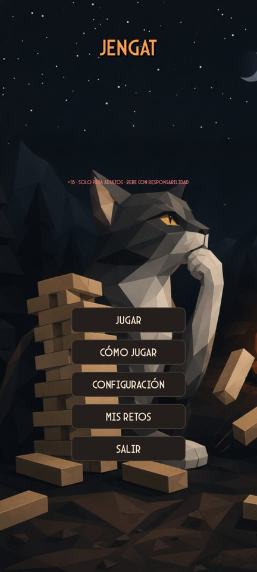
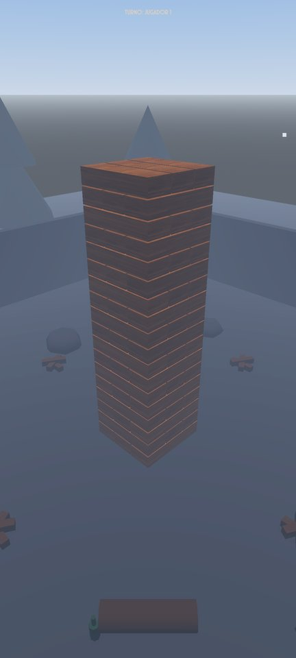

# Jengat

Juego de fiesta 3D para Android (Jenga + gato). Cada jugador saca un bloque de una torre con física real, cumple el reto que trae y pasa el teléfono; si la torre cae, pierde. Contenido para mayores de 18 años.

  
  

**Descargar**: [APK para Android 7 o superior](https://github.com/xJoffre/Jengat/releases/latest) (firmado con la clave de depuración, así que Android pide permitir la instalación de origen desconocido).

## Qué tiene

- **Física**: torre de 54 bloques (18 niveles de 3) hecha con `RigidBody3D` y Jolt Physics, arrastre táctil, cámara orbital, zoom con pellizco y detección de caída.
- **Retos**: un reto por bloque desde `data/challenges.json`, 6 categorías con color e icono, editor de retos propios (guardados en `user://custom_challenges.json`) y sin repetir retos en la misma sesión.
- **Partida**: turnos, estadísticas por jugador, confeti al cumplir un reto y una burla al azar al perder.
- **Mundo**: campamento low poly con fogatas, partículas, niebla, vibración y audio por escena.
- **Rendimiento**: renderer Compatibility (OpenGL) para correr estable en teléfonos de gama baja.

## Stack

Godot 4.6, GDScript, Jolt Physics.

## Cómo correrlo

1. Abrir la carpeta con Godot 4.6 (la escena principal es `scenes/Splash.tscn`).
2. Exportar a Android: `godot --headless --path . --export-debug "Android" build/jengat.apk` (necesita Android SDK, JDK 21 y un preset de exportación llamado `Android`).

El diseño completo está en [Documento_de_Diseno.md](Documento_de_Diseno.md).